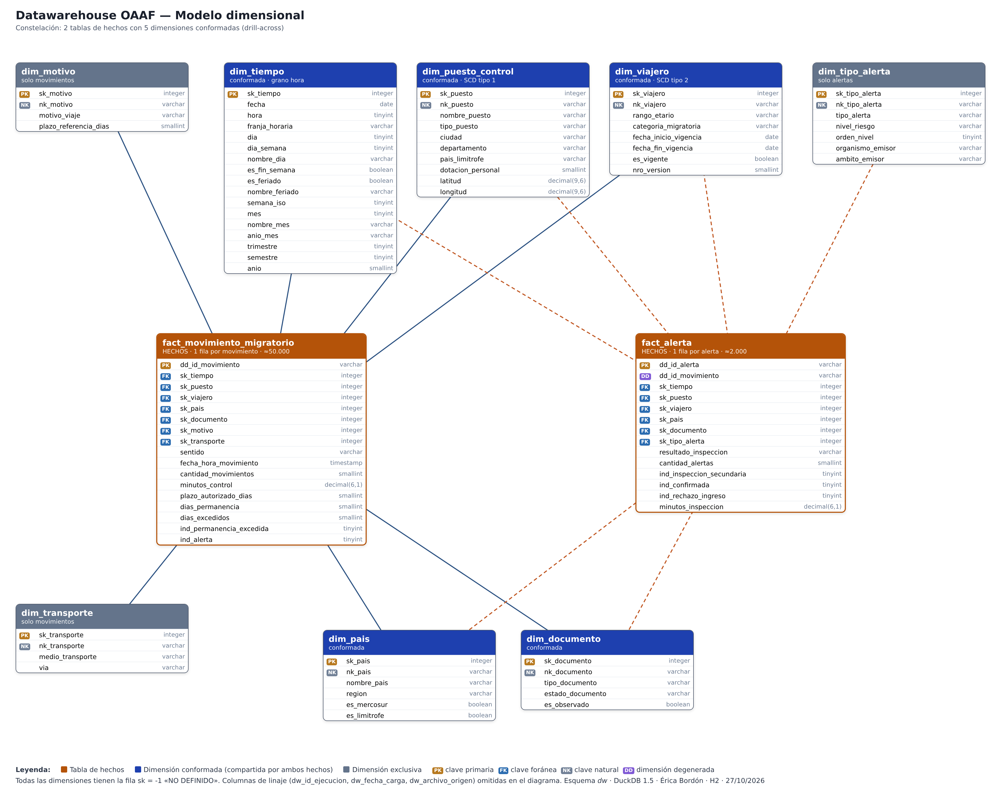

# Datawarehouse OAAF

Trabajo Práctico individual de la cátedra **Datawarehouse (22891)** — Universidad del Norte, Ingeniería Informática, 8.º semestre.
Docente: Lic. Walter Romero · Alumna: Érica Bordón

Datawarehouse de la **Oficina de Análisis Antiterrorista de Fronteras (OAAF)**, una organización pública ficticia que analiza los movimientos migratorios de 8 puestos de control de Paraguay. Todos los datos son sintéticos: no hay personas reales y los viajeros se identifican con un código seudónimo.

## Stack

DuckDB 1.5 · DBeaver · Python 3.12 + pandas · Power BI Desktop · Git

## Modelo

Constelación de dos tablas de hechos con cinco dimensiones conformadas:

- `fact_movimiento_migratorio` — una fila por movimiento (≈ 51.000)
- `fact_alerta` — una fila por alerta emitida (≈ 2.000)
- Dimensiones: tiempo (por hora), puesto de control (SCD 1), viajero (SCD 2), país, documento, motivo, transporte y tipo de alerta



## Estructura

```
01_ddl_dw_oaaf.sql                    Crea el modelo (10 tablas)
02_carga_dim_tiempo_y_catalogos.sql   Calendario y catálogos fijos
03_prueba_modelo.sql                  Prueba del modelo (SCD 2, drill-across)
fuentes/                              CSV, JSON y Excel con defectos deliberados
generador/generar_datos_oaaf.py       Genera las fuentes (semilla fija 22891)
etl/                                  ETL: staging, perfilado, transformación, carga, controles
docs/                                 Diagramas, matriz de bus, diccionario e informes
```

## Cómo ejecutarlo

1. En DBeaver, crear una conexión DuckDB a un archivo nuevo, por ejemplo `C:/DW_OAAF/dw_oaaf.duckdb`.
2. Ejecutar `01_ddl_dw_oaaf.sql` y `02_carga_dim_tiempo_y_catalogos.sql`.
3. Ejecutar el ETL: los scripts de `etl/` en orden (10 a 60) desde DBeaver, o todo junto con
   `pip install duckdb pandas openpyxl` y `python etl/etl_oaaf.py` (con DBeaver desconectado).

La base `.duckdb` no se sube al repositorio: se reconstruye con los scripts.

## Hitos

| Hito | Contenido | Estado |
| --- | --- | --- |
| H1 | Acta de definición de alcance | Entregado |
| H2 | Modelo dimensional, DDL y carga inicial en staging | Entregado |
| H3 | Dataset sintético y ETL completo | En curso |
| — | Consultas OLAP (P1 a P7) | Pendiente |
| — | Tablero en Power BI | Pendiente |
